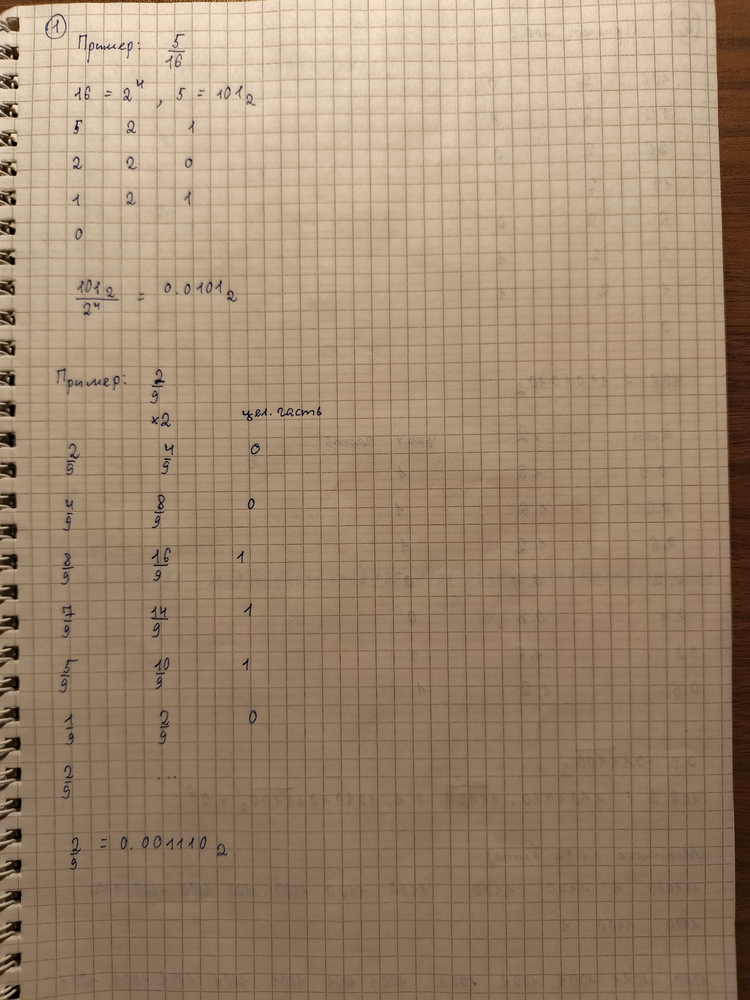
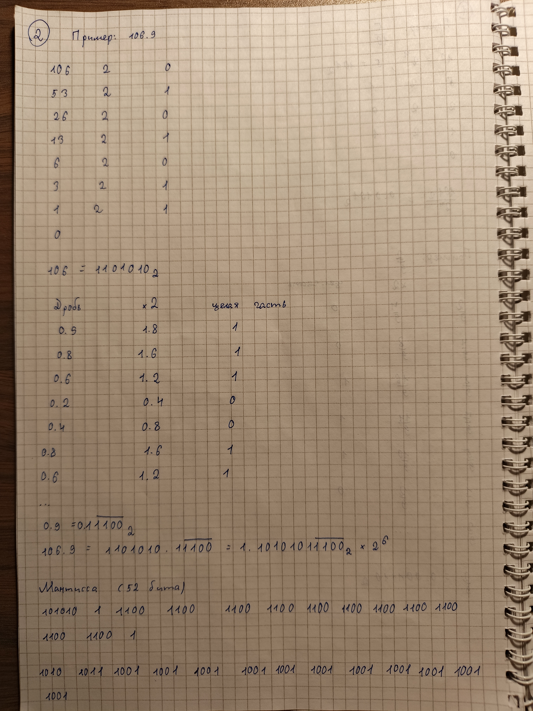
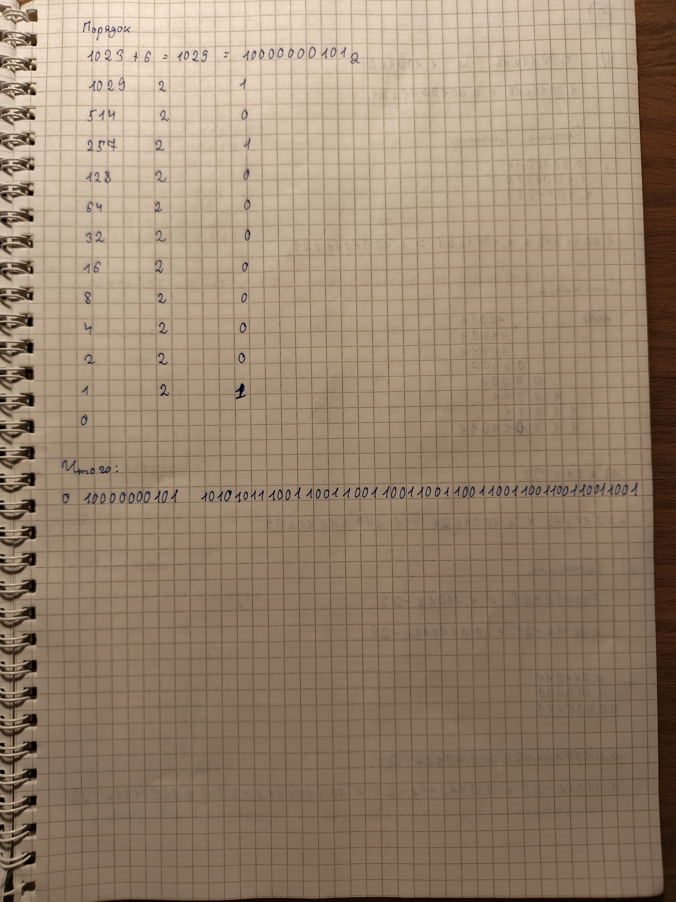
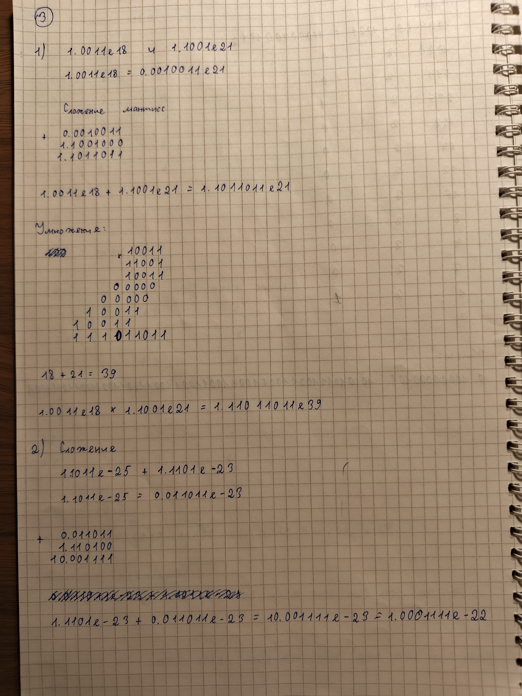
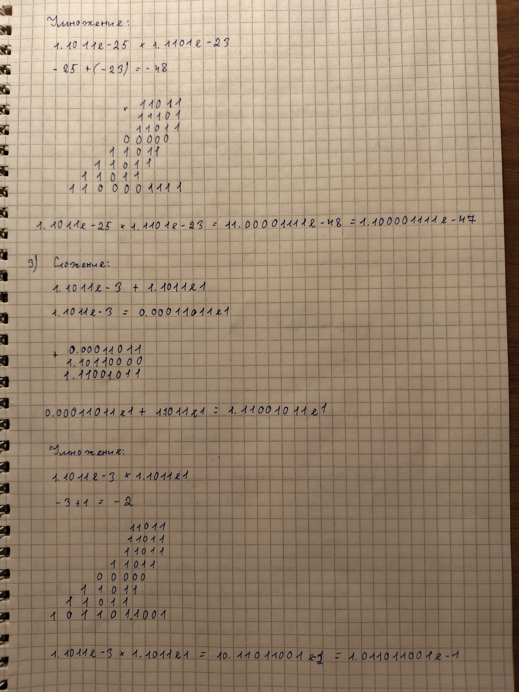
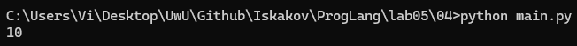
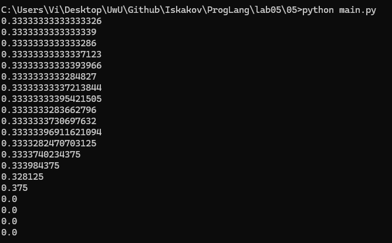
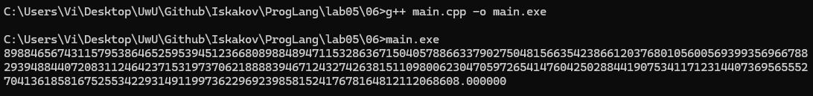
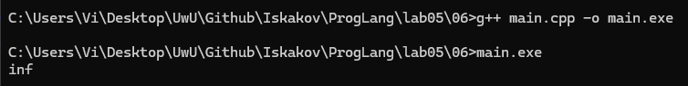
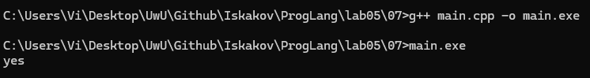

# Языки программирования
## Лабораторная работа 5

### Задание 1 **(2)**
*Переведите в двоичную запись два произвольных рациональных числа (числа вида* $\frac{p}{q}$).
*У одного из чисел знаменатель должен быть степенью двойки (32), а у другого --- некоторым числом
от 9 до 12.*

*Запись второго числа будет содержать период. Его надо найти. При решении задачи нельзя 
использовать вычислительную технику. Процесс решения должен быть представлен в отчете.*



### Задание 2 **(3)**
*Переведите в двоичную запись и найдите машинное представление в типе* **double**
*для произвольного вещественного числа большего, чем 100 с одним знаком после точки, например
для* $113.7$. *Цифра после точки не должна быть нулем иля пятеркой.*

*При решении задачи нельзя 
использовать вычислительную технику. Процесс решения должен быть представлен в отчете.*





### Задание 3 **(3)**
*Найдите сумму и произведение для записанных далее пар чисел. Числа заданы в двоичной записи 
в экспоненциальном виде. Ответ необходимо записать в нормализованннои экспоненциальном виде.*

* 1.0011e18 и $1.1001e21;
* 1.1011e-25 и, $1.1101e-23;
* 1.1011e-3 и $1.1011e1.
  
*При решении задачи нельзя 
использовать вычислительную технику. Процесс решения должен быть представлен в отчете.*





### Задание 4 **(2)**

*Рассмотрим следующий пример в IDLE Python*
```
>>> x = 99.99
>>> int(x/10+0.001)
9
```
*Результат должен был быть равен 10, однако оказался другим. Почему так произошло?
Как исправить программу, чтобы она корректно переводила вещественные числа в целые?*

**Объяснение**

Число `99.99` не может быть точно представлено в двоичной системе с плавающей точкой из-за периода. В результате может получиться так, что мы складываем не `9.999 + 0.001` как на бумаге, а `9.998 + 0.001` и не получаем 10, как ожидалось. 

Исправим код
```py
x = 99.99
x = round(x / 10)

print(x)
```

Используем функцию округления `round()` вместо того, чтобы пытаться сделать арифметические действия с типом `float`, который компьютер не всегда может хранить верно. 

Запустим и проверим результат



Получили число `10`. 

### Задание 5. **(2)**

*Рассмотрите следующую программу. Объясните результаты ее работы. В частности,
как величина* $y$ *повлияла на ответ?*
```
x = 1/3
y = 1
for i in range(20):
    print((x+y)-y)
    y*=10
```
*В отчете требуется привести вычисления для оценки погрешности.*

Для начала проверим выводы результатов



**Объяснение:**

**1. Итерация i = 0 (y = 1)**
* `y = 1`.
* `x = 0.3333333333333333`.
* Сумма `x + y = 1.3333333333333333` (всего 16 значащих цифр, лимит не превышен).
* При вычитании `y` мы получаем `0.3333333333333333`.
* Погрешность возникает только из-за того, что бесконечная двоичная дробь `1/3` обрезается на 16-м знаке. Именно поэтому мы видим `0.33333333333333326`. Стоит сказать, что скорее всего, в разных версиях питона последние цифры будут различаться из-за разных алгоритмов представления вещественных чисел.

**2. Итерация i = 10 (y = 10 000 000 000)**
* `y = 10^10` (это 11 значащих цифр - единица и 10 нулей).
* Лимит в 16 цифр на всё число.
* На дробную часть `x` остается `16 - 11 = 5` цифр.
* Поэтому при сложении `x + y` компьютер сохраняет значение как `10000000000.33333` (все цифры после пятого знака просто отброшены).
* При вычитании `y` (`10 000 000 000`) мы получаем `0.33333`.
* Погрешность. Мы потеряли хвост числа `1/3`, начиная с 6-го знака. Ошибка составляет примерно `0.000003333...`

**3. Итерация i = 19 (y = 10 000 000 000 000 000 000)**
* `y = 10^19` (это 20 значащих цифр: единица и 19 нулей).
* Чтобы сложить `10^19` и `0.333`, компьютер должен выровнять порядки: сдвинуть запятую у `0.333` на 19 позиций вправо. 
* Но для хранения `19` нулей и еще нескольких цифр `3` нам нужно минимум `20+` значащих цифр. У нас их всего 16.
* В результате все биты, отвечающие за значение `0.333`, просто выбрасываются из 53-битного окна и превращаются в ноль.
* Компьютер видит это сложение как: `10^19 + 0 = 10^19`.
* При вычитании `y` мы получаем: $10^{19} - 10^{19} = 0$.
* Погрешность. Полная потеря значения `x`. Ошибка равна ровно `1/3`.

### Задание 6 **(2)**

*Для какого минимального значения* $n$ *программа на С++ выведет* **inf**? *Объясните
ответ.* *Что произойдет, если тип* **double** *заменить на* **long double**?
```
int n=...;
double s = pow(2, n);
std::cout << std::fixed << s << std::endl;
```

**Минимальное значение `n` для получения `inf`:** `n = 1024`.

**Объяснение:**
Тип `double` занимает 64 бита: 1 бит знака, 11 бит порядка и 52 бита мантиссы. 
Порядок хранится со смещением. Для 11 бит смещение равно `2^10 - 1 = 1023`.
Максимальное значение 11-битной экспоненты для обычных чисел равно 2046 (так как значение 2047 зарезервировано стандартом специально для `inf` и `NaN`).

Следовательно, максимальный реальный порядок:
`2046 - 1023 = 1023`

**Что произойдет при замене на `long double`:**
Согласно лекции, тип `long double` имеет расширенную точность: 80 бит, где под порядок отведено 15 бит. 
Смещение для 15 бит равно `2^14 - 1 = 16383`.
Максимальная экспонента: `32766`.
Максимальный реальный порядок: `32766 - 16383 = 16383`.

Следовательно, для `long double` минимальное значение `n`, при котором будет выведено `inf`, равно `16384`.

*Примечение: я проверил работу программы с `long double`, но все равно получил `inf` при `1024`. Проверено в Visual Studio 2022 и g++ 14.2.0*

Протестируем программу с двумя значениями: `1023` и `1024`

**Тестируем `1023`**
```cpp
#include <iostream>
#include <cmath>

int main()
{
    int n = 1023;
    double s = pow(2, n);
    std::cout << std::fixed << s << std::endl;

    return 0;
}
```



Получилось огромное число, но все еще не `inf`.

**Тестируем `1024`**
```cpp
#include <iostream>
#include <cmath>

int main()
{
    int n = 1024;
    double s = pow(2, n);
    std::cout << std::fixed << s << std::endl;

    return 0;
}
```



Получили `inf`. Биты для хранения кончились. 

Замена `double` на `long double` даёт такой же результат, но надо сказать, что это зависит от компилятора. В моем случае long double все так же остался 64-битовым.

### Задание 7 **(2)**

*Допишите что-либо вместо многоточия программе на С++, чтобы программа при запуске выдавала ответ* **yes**.
```
double s = ...;
if (s != s)
  std::cout << "yes";
```

Что нужно? Чтобы вещественное число не было равно самому себе, но есть хитрость. Можем просто использовать проверку на `NaN == NaN`. 

Создадим main.cpp
```cpp
#include <iostream>
#include <cmath>

int main()
{
    double s = sqrt(-1);
    if (s != s)
        std::cout << "yes";

    return 0;
}
```

Компилируем, запускаем и проверяем ожидаемый результат



Все верно. 

### Задание 8 **(2)**

*Какое минимальное натуральное число при преобразовании в тип* **double** *записывается с погрешностью? Объясните
ответ. Почему следующее за ним число уже выводится без погрешности?*

**Минимальное натуральное число, записываемое с погрешностью:** 
`9007199254740993` (это `2^53 + 1`).

**Объяснение:**
Согласно стандарту IEEE 754, тип `double` имеет 52 бита для хранения мантиссы. Но за счет нормализации чисел мантисса всегда начинается с `1`, поэтому эта старшая единица скрыта и не записывается в память. 
Это дает точность в 53 бита.

53 бита позволяют точно представить любое целое число от `0` до `2^53`. 
Число `2^53 + 1` требует для своей точной двоичной записи уже 54 бита. Поскольку в мантиссе нет места для младшего бита, при преобразовании в `double` это число округляется до ближайшего представимого значения (`2^53`) и возникает погрешность.

**Почему следующее за ним число `2^53 + 2` выводится без погрешности?**
Число `2^53 + 2` (`9007199254740994`) чётное. В двоичной системе счисления оно заканчивается на `0`. При нормализации в формат с плавающей точкой этот младший ноль просто сдвигается за пределы 53-битной мантиссы, а значащие 53 бита нормально помещаются в отведенное место. Поэтому `2^53 + 2` представляется в памяти компьютера точно.

###  Задание 9 **(2)**
*Напишите программу для решения следующей задачи.*

*Даны четыре рациональных числа. (Рациональное число - это число вида*
$\frac{p}{q}$, *где* $p$ *и* $q$ - *целые числа.) Напишите программу, которая сравнит сумму
двух первых чисел с суммой двух последних чисел. Программа должна выводить* $1$, $0$ *или* $-1$
*в зависимости от результатов сравнения. Решение можно проверить в проверяющей системе*
[http://olymp3.isu.ru/cgi-bin/new-client?contest_id=102](http://olymp3.isu.ru/cgi-bin/new-client?contest_id=102), *задача 03*.

Создадим файл main.py

```py
t = int(input())

while t > 0:
    p1, q1, p2, q2, p3, q3, p4, q4 = map(int, input().split())

    e = q1 * q2
    a = p1 * q2
    b = p2 * q1

    f = q3 * q4
    c = p3 * q4
    d = p4 * q3

    x = a + b
    y = c + d

    z = e * f
    x *= f
    y *= e

    if x > y:
        print('1 ', end='')
    elif x < y:
        print('-1 ', end='')
    else:
        print('0 ', end='')

    t -= 1
```

Корректность работы программы проверена в проверяющей системе. Тесты пройдены. 

## Дополнительные задания

### Задание 1 **(3)**

*Чем отличаются машинные представления чисел* $1$, $4096$, $0.0625$, *в типе* **double**? *Почему?*

### Задание 2 **(4)**
*Напишите программу для решения следующей задачи.*

*Даны четыре вещественных числа
a,b,c,d, не превосходящие 100 по модулю, записанные не более чем с 10 знаками после точки.
Требуется сравнить суммы a+b и c+d и определить, какая из них больше. Возможен случай,
что суммы будут равны.* 

*От вас требуется обосновать выбор значения* **eps** *при сравнении.*

### Задание 3 **(5)**
*Задано вещественное число в десятичной записи. Напишите программу для нахождения первых 1000 разрядов
этого числа в двоичной записи.*


### Задание 4 **(3)**
*Изучая чужой код, программист обнаружил такую функцию.*
```
long double acos_e(long double x, long double ep){
  if (x > 1+ep || x < -1-ep)
    return 0.0 / 0.0;
  else if (x>1)
    x=1;
  else if (x<-1)
    x=-1;
  return acos(x);
}
```
*Чем отличается эта функция от обычной функции арккосинуса? В чем смысл дополнительных проверок?*
### Задание 5 **(5)**
*Заданы координаты точек* $A$, $B$, $C$ *на плоскости. Координаты являются вещественными числами в диапазоне* $[0;10)$
*и содержат не более 6 знаков после точки. Используя формулу векторного произведения, напишите программу
для определения расположения* $C$ *относительно вектора* $AB$ *(слева, справа, на прямой).*

*От вас требуется обосновать выбор значения* **eps** при сравнении.*