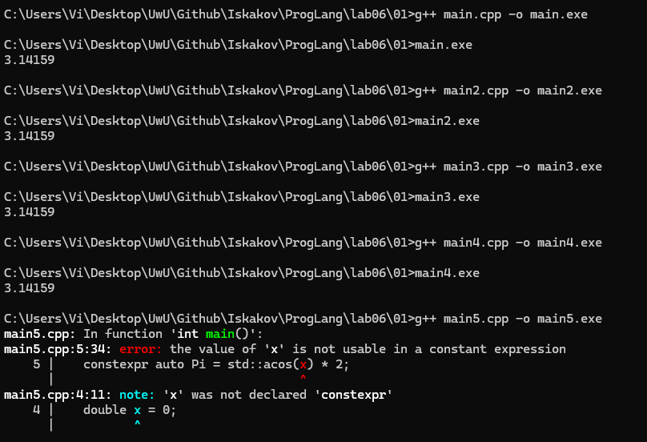
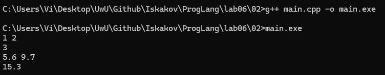
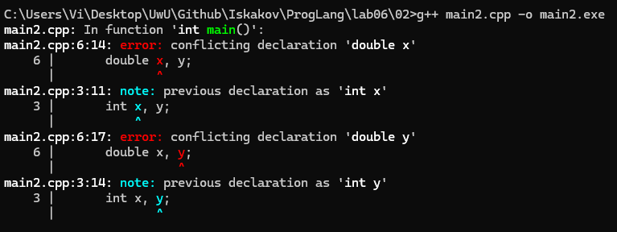
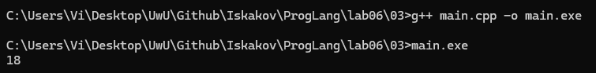
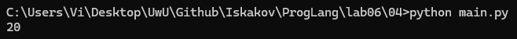
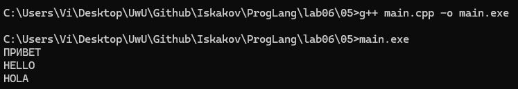
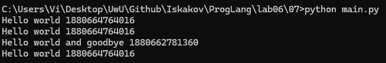
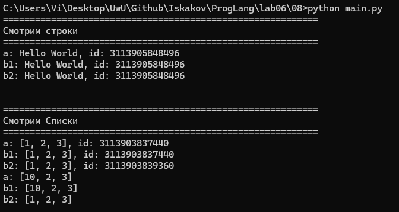
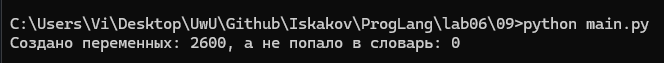

# Языки программирования
## Лабораторная работа 6

### Задание 1 **(3)**
*Рассмотрим следующую программу на С++.*
```
#include <iostream>
#include <cmath>
int main() {
   double x = 0;
   const auto Pi = std::acos(0) * 2;
   std::cout << Pi << std::endl;
   return 0;
}
```
*Проверьте четыре способа объявления* **Pi**.
* ```const auto Pi = acos(0) * 2;```
* ```constexpr auto Pi = std::acos(0) * 2;```
* ```const auto Pi = acos(x) * 2;```
* ```constexpr auto Pi = std::acos(x) * 2;```

*Что можно сказать об этих вариантах? Проверьте, в каких вариантах объявляется константа этапа трасляции.*

*Тексты программ разместите в папке с номером задания*

**Сразу же запустим программу и проверим результат**



**Вывод мало что показал, а константу времени компиляции можно объявить и как const, и как constexpr, поэтому надо найти другой способ доказать, что именно является константой этапа трансляции.**

**const auto Pi = acos(0) * 2;**
---

**constexpr auto Pi = std::acos(0) * 2;**
---

**const auto Pi = acos(x) * 2;**
---

**constexpr auto Pi = std::acos(x) * 2;**

Ошибка компиляции: "the value of `x` is not usable in a constant expression". `constexpr` требует чтобы всё выражение справа можно было вычислить на этапе компиляции. Переменная `x` не является константой времени компиляции (ошибка "`x` was not declared `constexpr`). 

*Я хотел расписать каждый вариант, но не нашел способа доказать, что будет вычислено на этапе компиляции, а что - на этапе запуска программы. Я могу лишь предположить, что константа этапа трансляции будет здесь `constexpr auto Pi = std::acos(0) * 2;` по двум причинам. Мы объявляем ее правильно с `constexpr` и используем целочисленный литерал (`0`) для вычисления значения сразу же (не используем какие-то переменные).*

### Задание 2 **(2)**
*Проверьте работу следующей программы на С++*
```cpp
#include <iostream>
int main() {
   {
      int x, y;
      std::cin >> x >> y;
      std::cout << x+y << std::endl;
   }
   {
      double x, y;
      std::cin >> x >> y;
      std::cout << x+y << std::endl;
   }
   return 0;
}
```
*Нужны ли в этой программе вложенные фигурные скобки? Дайте подробный ответ с объяснением причин.*

**Запустим программу и проверим результат**



**Объяснение:**

Фигурные скобки `{}` создают область видимости. В примере области не вложенные. Переменные `int x, y` и `double x, y` не конфликтуют.
Если убрать фигурные скобки, произойдет ошибка конфликтующих переменных. Докажем это, убрав скобки.

```cpp
#include <iostream>
int main() {
      int x, y;
      std::cin >> x >> y;
      std::cout << x+y << std::endl;
      double x, y;
      std::cin >> x >> y;
      std::cout << x+y << std::endl;
   return 0;
}
```

**Запустим программу и проверим результат**



**Объяснение:**

Ошибка `conflicting declaration` как раз указывает на конфликтующие имена переменных. Следовательно, фигурные скобки в этой программе необходимы. 

### Задание 3 **(2)**
*Проверьте работу следующего фрагмента программы на С++.*
```
int s = 0;
for (int i = 0; i < 4; i++) {
   for (int i = 0; i < 3; i++) {
      s += i;
   } 
   s += i; 
}
std::cout << s;
```
*В результате каких вычислений был получен ответ? Дайте подробный ответ.*

**Создадим файл main.cpp**

```cpp
#include <iostream>

int main()
{
    int s = 0;
    for (int i = 0; i < 4; i++)
    {
        for (int i = 0; i < 3; i++)
        {
            s += i;
        }
        s += i;
    }
    std::cout << s;

    return 0;
}
```

**Запустим программу и проверим результат**



**Вычислим пошагово:**

Вычислим пошагово:
1. Внешний цикл `i = 0`
Внутренний цикл
- s += 0 (s = 0)
- s += 1 (s = 1)
- s += 2 (s = 3)
Выход из внутреннего цикла
- s += 0 (s = 3)

2. Внешний цикл `i = 1`
Внутренний цикл
- s += 0 (s = 3)
- s += 1 (s = 4)
- s += 2 (s = 6)
Выход из внутреннего цикла
- s += 1 (s = 7)

3. Внешний цикл `i = 2` 
Внутренний цикл
- s += 0 (s = 7)
- s += 1 (s = 8)
- s += 2 (s = 10)
Выход из внутреннего цикла
- s += 2 (s = 12)

3. Внешний цикл `i = 3`
Внутренний цикл
- s += 0 (s = 12)
- s += 1 (s = 13)
- s += 2 (s = 15)
Выход из внутреннего цикла
- s += 3 (s = 18)

**Объяснение**
Внутренний цикл объявляет свою переменную `i`, которая вытесняет внешнюю переменную `i` из области видимости (особенность языка C++). После выхода из внутреннего цикла внутренняя `i` уничтожается, и внешняя `i` снова доступна.

### Задание 4 **(2)**

*Проверьте работу следующего фрагмента программы на* **Python**.
```
s = 0
for i in range(4):
   for i in range(3):
      s += i
   s += i
print(s)
```
*В результате каких вычислений был получен ответ? Дайте подробный ответ.*

*На основе этих примеров поясните различия между* **С++** и **Python** *при работе с переменными*.

**Запустим программу и проверим результат**



**Вычислим пошагово:**

1. Внешний цикл `i = 0`
Внутренний:
- s += 0 (s = 0)
- s += 1 (s = 1)
- s += 2 (s = 3)
Выход из внутреннего цикла
- s += 2 (s = 5)

2. Внешний цикл `i = 1`
Внутренний:
- s += 0 (s = 5)
- s += 1 (s = 6)
- s += 2 (s = 8)
Выход из внутреннего цикла
- s += 2 (s = 10)

3. Внешний цикл `i = 2`
- s += 0 (s = 10)
- s += 1 (s = 11)
- s += 2 (s = 13)
Выход из внутреннего цикла
- s += 2 (s = 15)

4. Внешний цикл `i = 3`
- s += 0 (s = 15)
- s += 1 (s = 16)
- s += 2 (s = 18)
Выход из внутреннего цикла
- s += 2 (s = 20)

**Объяснение разници работы с переменными в C++ и Python**

**C++** создает новую переменную во внутреннем цикле, которая живет только в области видимости внутреннего цикла и удаляется при выходе из внутреннего цикла. (Цикл `for` сам по себе создает блок).
**Python** переменная цикла `for` не имеет своей области видимости, из-за чего внутренний цикл перезаписывает внешнюю переменную `i`. 

### Задание 5 **(2)**

*Напишите свой пример программы на* **С++**, *создающий и использующий пространства имен. Программа
должна содержать не менее двух пространств имен.*

**Создадим main.cpp**

```cpp
#include <iostream>

namespace RUS {
    std::string greet() {
        return "ПРИВЕТ";
    }
}

namespace ENG {
    std::string greet() {
        return "HELLO";
    }
}

namespace ESP {
    std::string greet() {
        return "HOLA";
    }
}

int main() {
    std::cout << RUS::greet() << "\n";
    std::cout << ENG::greet() << "\n";
    std::cout << ESP::greet() << "\n";

    return 0;
}
```

**Запустим программу и проверим результат**



Программа работает корректно.

### Задание 6 **(2)**

*Рассмотрим следующий фрагмент программы. Эта программа 1000000 раз обменивает значения двух длинных 
строк с использованием третьей строки. Проверьте, насколько быстро она работает.*

```
std::string a(100000, 'a');
std::string b(100000, 'b');
for (int i=0;i<1000000;i++) {
   std::string c(a);
   a = b ;
   b = c;
}
std::cout << a[0] << b[0];
```
*Попробуйте использовать для обмена значений строк функцию* **swap**. 
*Проверьте, изменилось ли время работы. В чем ошибка исходной программы?
Исправьте исходную программу, чтобы ускорить ее работу. Изменения не должны 
затрагивать общий вид программы (присваивания, использование временной переменной).*

**Исправим программу**

```cpp
#include <iostream>

int main()
{

    std::string a(100000, 'a');
    std::string b(100000, 'b');
    for (int i = 0; i < 1000000; i++)
    {
        std::string c(std::move(a));
        a = std::move(b);
        b = std::move(c);
    }
    std::cout << a[0] << b[0];
    return 0;
}
```

**Почему стало быстро?**

Использовали семантику перемещения (`move()`), в которой содержиемое строки или контейнера переносится из одной переменной в другую, при этом содержимое переменной, откуда произошло перемещение становится пустым и копирование содержимого не происходит.

### Задание 7 **(2)**

*Рассмотрим программу на языке* **Python**.
```
a = 'Hello world'
print(a, id(a))
b = a
print(b, id(b))
a += ' and goodbye'
print(a, id(a))
print(b, id(b))
```
*Объясните ее работу. В какой момент создавались строки?* 
*Что означает значение, возвращенное функцией* **id**?*



**Объяснение:**

`a = 'Hello world'` ссылается на объект в памяти.
`b = a` ссылается на тот же объект (а), так как в общем случае `a = b` является присваиванием ссылок.
`a += ' and goodbye'` создает новую строку, так как строки в **Python** неизменяемые. Таким образом создается новый объект в памяти и `a` теперь ссылается на другой объект. 
`b` продолжает ссылаться на старый объект (когда мы создали `a = 'Hello world')`.

Значение, возвращаемое функцией `id()`, означает местоположение объекта в памяти. 

### Задание 8 **(2)**

*Пусть* **a** - *строковая переменная в программе на* **Python**.
*Есть ли разница между работой присваивания*
```b = a```
и
```b = a[:]```
*Напишите программу для демонстрации различий.*

**Создадим main.py**
```py
print("===========================================================")
print("Смотрим строки")
print("===========================================================")
a = "Hello World"
b1 = a
b2 = a[:]
print(f"a: {a}, id: {id(a)}")
print(f"b1: {b1}, id: {id(b1)}")
print(f"b2: {b2}, id: {id(b2)}")

print("\n")
print("===========================================================")
print("Смотрим Списки")
print("===========================================================")
a = [1, 2, 3]
b1 = a
b2 = a[:]

print(f"a: {a}, id: {id(a)}")
print(f"b1: {b1}, id: {id(b1)}")
print(f"b2: {b2}, id: {id(b2)}")

a[0] = 10
print(f"a: {a}")
print(f"b1: {b1}")
print(f"b2: {b2}")
```

**Запустим программу и проверим результат**



**Объяснение**

Для строк ничего не поменялось, так как Python создает одинаковые объекты (строки неизменяемые). Все три id совпадают.
Для списков все иначе. 
`b1 = a` - это ссылка на тот же список `a`. id одинаковый. Меняем `a`, меняется и `b1`.
`b2 = a[:]` - это копия списка и id другой. Меняем `a`, `b2` остаётся прежним.
На скриншоте видно, что после `a[0] = 10` список `b1` стал `[10, 2, 3]`, а `b2` остался `[1, 2, 3]`.

###  Задание 9 **(3)**
*Напишите программу на языке* **Python**, *которая создаст 2600 переменных с именами
от* **a0** *до* **a99**, *от* **b0** *до* **b99** *и так далее, от* **z0** *до* **z99**. 
*Присвойте всем переменным различные значения от 1 до 2600.*

**Создадим main.py**

```py
# запишем все буквы англ. алфавита
letters = 'abcdefghijklmnopqrstuvwxyz'

# тут храним все созданные имена переменных
vars_list = []

# счетчик, чтобы присвоить всем переменным значения от 1 до 2600
cnt = 1

# внешний цикл по буквам a-z
for i in letters:
    # внутренний цикл по числам от 0 до 99
    for j in range(100):
        # формирование имени переменной
        var_name = i + str(j)

        # добавление переменной в словарь переменных
        vars()[var_name] = cnt
        cnt += 1

        # добавление имени переменной в список
        vars_list.append(var_name)


# тут будет отслеживать сколько не попало в словарь
not_found = 0

for v in vars_list:
    # если переменная с таким именем не в словаре, увеличиваем счетчик
    if v not in vars_list:
        not_found += 1

print(f"Создано переменных: {len(vars_list)}, а не попало в словарь: {not_found}")
```

**Запустим и проверим результат**



*Объяснение кода см. в комментариях*

**Объяснение второй части кода:**

Спорное решение, но я искал в задании подвох и решил проверить, что в словарь были добавлены 2600 переменных, и ни одна не потерялась. У меня была мысль, что из-за количества переменных словарь лопнет, но я искал подвох там, где его нет и на самом деле 2600 переменных - это очень мало.  

## Дополнительные задания

### Задание 1 **(3)**

*Пусть* **a**, **b**  *два списка в* **Python**. *Мы хотим обменять значения переменных следующим
образом.*
```
a, b = b, a
```
*Будет ли это работать? В какой последовательности будут происходить присваивания?
Будет ли зависеть время работы от размера списков? Обоснуйте ответ.*

### Задание 2 **(3)**
*Проверьте результаты сравнения в* **Python**.
```
id(100)==id(100)
```
и
```
id(1000)==id(1000)
```
*Как можно объяснить полученные результаты?*

### Задание 3 **(4)**
*Напишите функцию* **sumint** на **Python**, *которая найдет сумму всех целочисленных переменных, определенных
в среде* **Idle**. *Например*
```
>>> a = 10
>>> b = 1.5
>>> c = 15
>>> d = 'hello'
>>> sumint()
25
```

### Задание 4 **(10)**

*В языке* **С++** *для получения информации о расположении переменной в памяти 
можно использовать оператор взятия адреса* **&**. *Адрес можно интерпретировать, как 
беззнаковое длинное число с использованием* **reinterpret_cast**.

```
reiterpret_cast<unsigned long long>(&t);
```
*Здесь* **t** *имя некоторой переменной. Напишите несколько примеров, чтобы проверить, 
как размещаются переменные в памяти. В частности, можно рассмотреть следующие вопросы.*
* *Если объявить несколько переменных различных типов в одном блоке, то на какую величину 
отличаются их адреса? Соотносится ли эта величина с размером переменной в байтах.
Проверьте, имеются ли различия на разных уровнях оптимизации.*
* *Если имеется несколько блоков, расположенных последовательно, то могут ли переменные
в разных блоках иметь одинаковые адреса? Проверьте разные уровни оптимизации.*
* *Объявите несколько переменных типа* **std::string** *и попробуйте заносить
в них строки различной длины. Изменяется ли размер переменной, вычисленный с использованием*
**sizeof**? *Изменяется ли расположение переменной? Попробуйте объяснить полученные результаты.*

