# Языки программирования
## Лабораторная работа 7

### Задание 1 **(2)**
*Оцените работу следующих фрагментов программ. Какие из них обладают неоднозначным поведением? Почему?*
```
int x=10, y=3;
std::cout << std::min(x=15, x+y);
```
```
int x=10, y=3;
x=15, y+=x, x+=y;
```
```
int x=10, y=9;
if (x>y++ && y++>9)
  cout << "yes" << endl;
cout << y;
```

*Тексты программ разместите в папке с номером задания*

**Создадим файл main.cpp**
```cpp
#include <iostream>

int main()
{
    int x = 10, y = 3;
    std::cout << std::min(x = 15, x + y);

    return 0;
}
```

**Компиляция, запуск, проверка результата:**

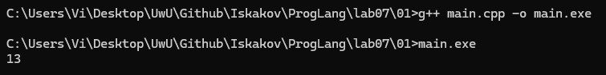

**Объяснение**

Согласно стандарту: Order of evaluation of any part of any expression, including order of evaluation of function arguments is unspecified (with some exceptions listed below).
https://en.cppreference.com/cpp/language/eval_order

Что в переводе говорит: порядок вычисления части выражения, в том числе и аргументов функции неопределен (кроме исключений ниже). Таким образом, аргументы функции `min` могут быть вычислены в разном порядке или не вычислены вовсе до вызова функции. Результат программы может быть разным. 

**Создадим файл main2.cpp**
```cpp
#include <iostream>

int main()
{
    int x = 10, y = 3;
    x = 15, y += x, x += y;

    std::cout << "x: " << x << ", " << "y: " << y << std::endl;

    return 0;
}
```

**Компиляция, запуск, проверка результата:**

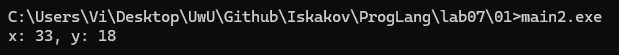

**Объяснение**

Поведение однозначное. Используется оператор `,`. Правый операнд упорядочен после левого. Порядок такой:
1. x = 15
2. y += x -> 3 + 15 = 18
3. x += y -> 15 + 18 = 33

**Создадим файл main3.cpp**
```cpp
#include <iostream>

int main()
{
    int x = 10, y = 9;
    if (x > y++ && y++ > 9)
        std::cout << "yes" << std::endl;
    std::cout << y;

    return 0;
}
```

**Компиляция, запуск, проверка результата:**

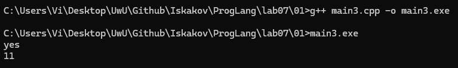

**Объяснение**

Все однозначно. Оператор `&&` гарантирует порядок вычисления строго слева направо с учетом скобок и приоритетов. Порядок такой:
1. x > y++ -> x > 9, потом y++ (y = 10), результат true
2. y++ > 9 -> 10 > 9, потом y++ (y = 11), результат true
3. true && true = true

### Задание 2 **(2)**
*Как записать следующие строки программы на С++ в виде одного
выражения? Приведите несколько способов, в том числе с использованием операторов инкремента.*
*Проверьте работу написанных программ*
```
x=x+1;
z=z+2*x+3*y;
y=y+1;
```
*Тексты программ разместите в папке с номером задания*

**Создадим файл main.cpp**
```cpp
#include <iostream>

int main()
{
    int x = 1;
    int y = 2;
    int z = 3;

    x = x + 1;
    z = z + 2 * x + 3 * y;
    y = y + 1;

    std::cout << "x: " << x << ", " << "y: " << y << ", " << "z: " << z << std::endl;

    return 0;
}
```

**Компиляция, запуск, проверка результата:**

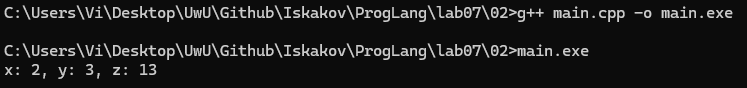

**Создадим файл main2.cpp**
```cpp
#include <iostream>

int main()
{
    int x = 1;
    int y = 2;
    int z = 3;

    x = x + 1, z = z + 2 * x + 3 * y, y = y + 1;

    std::cout << "x: " << x << ", " << "y: " << y << ", " << "z: " << z << std::endl;

    return 0;
}
```

**Компиляция, запуск, проверка результата:**

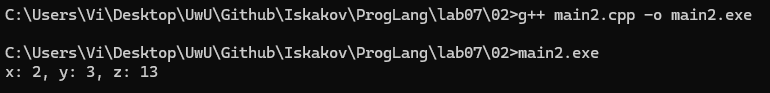

**Создадим файл main3.cpp**
```cpp
#include <iostream>

int main()
{
    int x = 1;
    int y = 2;
    int z = 3;

    z = z + 2 * (++x) + 3 * (y++);

    std::cout << "x: " << x << ", " << "y: " << y << ", " << "z: " << z << std::endl;

    return 0;
}
```

**Компиляция, запуск, проверка результата:**

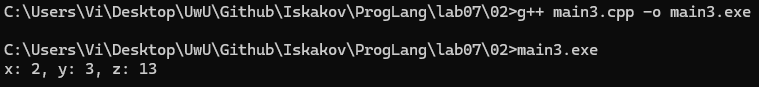

**Создадим файл main4.cpp**
```cpp
#include <iostream>

int main()
{
    int x = 1;
    int y = 2;
    int z = 3;

    z += 2 * (x += 1) + 3 * y, y += 1;

    std::cout << "x: " << x << ", " << "y: " << y << ", " << "z: " << z << std::endl;

    return 0;
}
```

**Компиляция, запуск, проверка результата:**

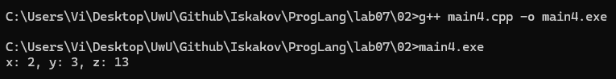

### Задание 3 **(2)**
*Рассмотрите следующий фрагмент программы. Он заполняет вектор из 10 элементов единицами.*
```
std::vector<int> x(10);
for (int i = 0; i < 10;)
   x[i++] = 1;
```
*Перепишите ее так, чтобы в третьей строке использовался префиксный инкремент, но результат ее работы не изменился.*
```
std::vector<int> x(10);
for (...)
   x[++i]=1;
```

**Создадим файл main.cpp**
```cpp
#include <iostream>
#include <vector>

int main()
{
    std::vector<int> x(10);
    for (int i = 0; i < 10;)
        x[i++] = 1;

    for (int a : x)
    {
        std::cout << a << " ";
    }

    return 0;
}
```

**Компиляция, запуск, проверка результата:**

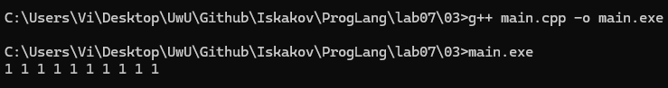

**Создадим файл main2.cpp**
```cpp
#include <iostream>
#include <vector>

int main()
{
    std::vector<int> x(10);
    for (int i = -1; i < 9;)
        x[++i] = 1;

    for (int a : x)
    {
        std::cout << a << " ";
    }

    return 0;
}
```

**Компиляция, запуск, проверка результата:**

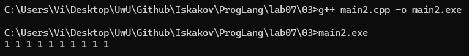

### Задание 4 **(2)**

*Почему присваивание* ```(++x)=y``` *является синтаксически правильным, а*
```(x++)=y``` - *нет? Запишите текст сообщения об ошибке, переведите и объясните его.*

**Создадим файл main.cpp**
```cpp
#include <iostream>

int main()
{

    int x = 1;
    int y = 2;
    (++x) = y;

    std::cout << "x: " << x << ", " << "y: " << y << std::endl;

    return 0;
}
```

**Компиляция, запуск, проверка результата:**

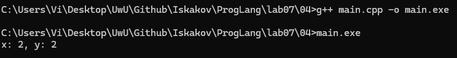

**Создадим файл main2.cpp**
```cpp
#include <iostream>

int main()
{

    int x = 1;
    int y = 2;
    (x++) = y;

    std::cout << "x: " << x << ", " << "y: " << y << std::endl;

    return 0;
}
```

**Компиляция, запуск, проверка результата:**

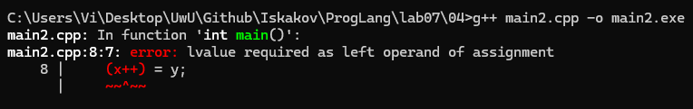

**Сообщение об ошибке:** lvalue required as left operand of assignment

**Перевод:** требуется lvalue как левый операнд присваивания

**Объяснение:** 

Результатом работы `++x` является lvalue, а `x++` - rvalue. Объект категории lvalue можно использовать в левой части присваивания, если он не является константным. 

### Задание 5 **(2)**

*Программисты на Python для обмена значений двух переменных часто пишут строку*
```
a,b = b,a
```
*Проверьте, будет ли аналогичная строка на С++ (с точкой с запятой в конце) являться синтаксически
правильной? Будет ли она обменивать значения переменных? Как в языке С++ вычисляется это выражение?*

**Создадим файл main.cpp**
```cpp
#include <iostream>

int main() {   
    int a = 1;
    int b = 2;

    a,b = b,a;

    std::cout << "a: " << a << ", " << "b: " << b << std::endl;

    return 0;
}
```

**Компиляция, запуск, проверка результата:**

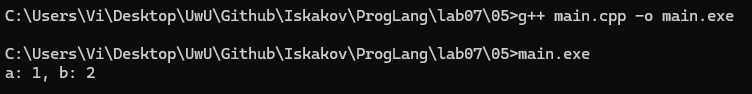

**Результат: a = 1, b = 2**

**Объяснение:**

Программа является синтаксически правильной. С точки зрения токенизатора происходит следующее:
1. `a` просто вычисляется (то есть это просто `a`), потом оператор `,`
2. `b = b`, потом оператор `,`
3. `b` вычисляется, потом точка с запятой

### Задание 6 **(2)**

*Проверьте работу следующего фрагмента программы*
```
  std::string s;
  for (int i=0; i<1000000; i++)
     s += 'a';
  std::cout << s.size();
```
*Измените третью строку на*
```
s=s+'a';
```
*Изменится ли что-нибудь в ее работе? Объясните результат.*

**Результат после замены на `s=s+'a';`**

Программа стала работать в разы медленнее. 

*Примечание: скриншоты запуска и результата работы программа не будут приложены, так как они ничего не покажут без написания кода для измерения времени работы программы, например, с `chrono`.*

**Объяснение:**

Обратимся к стандарту. 

Оператор `+=`. 
https://en.cppreference.com/cpp/string/basic_string/operator+=

Написано *appends* и *`*this` (return value)*, то есть он приклеивает строку или символ к строке, потом возвращает ссылку на тот же самый объект, не создавая копии.

Оператор `+`.
https://en.cppreference.com/cpp/string/basic_string/operator+

Написано *Returns a string containing characters from...*, то есть возвращает новую строку, с символами из оригинальной строки и новыми приклеенными. 

Таким образом, после изменения на `s=s+'a'` каждый раз создается копия строки, и так миллион раз, а количество символов для копирования также увеличивается. Это как цикл внутри цикла. 

### Задание 7 **(2)**

*Как работает следующая программа? Как зависит результат от исходного значения?*
```
int x;
std::cin >> x;
x-->0 && x-->0 && x-->0 && x-->0 && x-->0;
std::cout << x;
```

Чтобы понять, как работает программа, рассмотрим правила:
1. Разобьем программу на токены
2. Расставим приоритеты операций (сначала `--`, потом `>`, потом `&&`)
3. Последовательность конъюкции по стандарту С++ - строго слева направо
4. Посмотреть побочные действия (пять применений `--`)
5. По стандарту С++ при вычислении `&&` побочные действия, связанные с вычислением левого операнда упорядочены до вычисления правого и наоборот тоже.
6. По стандарту С++, если левый операнд `&&` равен false, то вычисление правого не выполняется.
7. Суффиксный `--` происходит после вычисления результата

**Создадим файл main.cpp**

```cpp
#include <iostream>

int main()
{
    int x;
    std::cin >> x;
    x-- > 0 && x-- > 0 && x-- > 0 && x-- > 0 && x-- > 0;
    std::cout << x;

    return 0;
}
```

**Компиляция, запуск, проверка результата:**

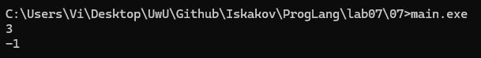

Пошагово для x = 3:
1. 3 > 0 -> true, 3-- -> 2
2. 2 > 0 -> true, 2-- -> 1
3. 1 > 0 -> true, 1-- -> 0
3. 0 > 0 -> false, 0-- -> -1

Пошагово для x = 5:
1. 5 > 0 -> true, 5-- -> 4
2. 4 > 0 -> true, 4-- -> 3
3. 3 > 0 -> true, 3-- -> 2
4. 2 > 0 -> true, 2-- -> 1
5. 1 > 0 -> true, 1-- -> 0

### Задание 8 **(3)**

*Какое число выводит следующий фрагмент программы? Посчитайте результат без использования
вычислительной техники. Отчет должен содержать процесс вычислений.*
```
int s = 0;
for (int i = 0, j = 5;i+j <= 16;(i<j ? i : j)++)
   (s += i) += j;
std::cout << s;
```

**Создадим файл main.cpp для проверки, затем посчитаем вручную**

```cpp
#include <iostream>

int main()
{
    int s = 0;
    for (int i = 0, j = 5; i + j <= 16; (i < j ? i : j)++)
        (s += i) += j;
    std::cout << s;

    return 0;
}
```

**Компиляция, запуск, проверка результата:**

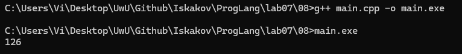

**Результат: 126**

1. 
- i = 0
- j = 5
- i + j = 5
- s += 0 (s = 0)
- s += 5 (s = 5)
- i++ (i = 1)
2. 
- i = 1
- j = 5
- i + j = 6
- s += 1 (s = 6)
- s += 5 (s = 11)
- i++ (i = 2)
3. 
- i = 2
- j = 5
- i + j = 7
- s += 2 (s = 13)
- s += 5 (s = 18)
- i++ (i = 3)
4. 
- i = 3
- j = 5
- i + j = 8
- s += 3 (s = 21)
- s += 5 (s = 26)
- i++ (i = 4)
5. 
- i = 4
- j = 5
- i + j = 9
- s += 4 (s = 30)
- s += 5 (s = 35)
- i++ (i = 5)
6. 
- i = 5
- j = 5
- i + j = 10
- s += 5 (s = 40)
- s += 5 (s = 45)
- j++ (j = 6)
7. 
- i = 5
- j = 6
- i + j = 11
- s += 5 (s = 50)
- s += 6 (s = 56)
- i++ (i = 6)
8. 
- i = 6
- j = 6
- i + j = 12
- s += 6 (s = 62)
- s += 6 (s = 68)
- j++ (j = 7)
9. 
- i = 6
- j = 7
- i + j = 13
- s += 6 (s = 74)
- s += 7 (s = 81)
- i++ (i = 7)
10. 
- i = 7
- j = 7
- i + j = 14
- s += 7 (s = 88)
- s += 7 (s = 95)
- j++ (j = 8)
11. 
- i = 7
- j = 8
- i + j = 15
- s += 7 (s = 102)
- s += 8 (s = 110)
- i++ (i = 8)
12. 
- i = 8
- j = 8
- i + j = 16
- s += 8 (s = 118)
- s += 8 (s = 126)
- j++ (j = 9)
13. 
- i = 8
- j = 9
- i + j = 17
Стоп.

**Результат: s = 126. Совпадает.**

###  Задание 9 **(3)**
*Рассмотрите следующую программу. Предполагается, что на вход подается некоторый
индекс в массиве - число от нуля до девяти и значение, которое надо записать по этому индексу.*
```
int i = 0;
std::vector<int> x(10);
std::cin >> i >> x[i];
std::cout << x[i];
```
*Проверьте работу этой программы на различных компиляторах. Найдите два компилятора (можно 
проверить онлайн компиляторы), на которых эта программа будет давать различные ответы при одинаковом
вводе. Как это объяснить?*

**Создадим файл main.cpp**
```cpp
#include <iostream>
#include <vector>

int main()
{
    int i = 0;
    std::vector<int> x(10);
    std::cin >> i >> x[i];
    std::cout << x[i];

    return 0;
}
```

**Проверим работу в компиляторе g++ 14.2.0**

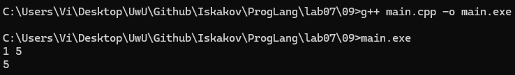

**Результат: 5**

**Проверим работу в компиляторе Visual Studio 2022 Debug x64**

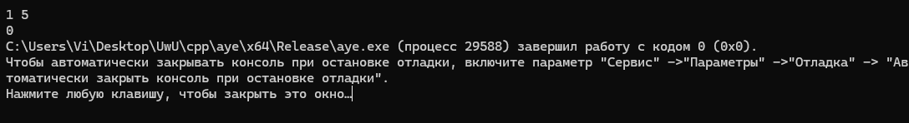

**Результат: 0**

**Объяснение**

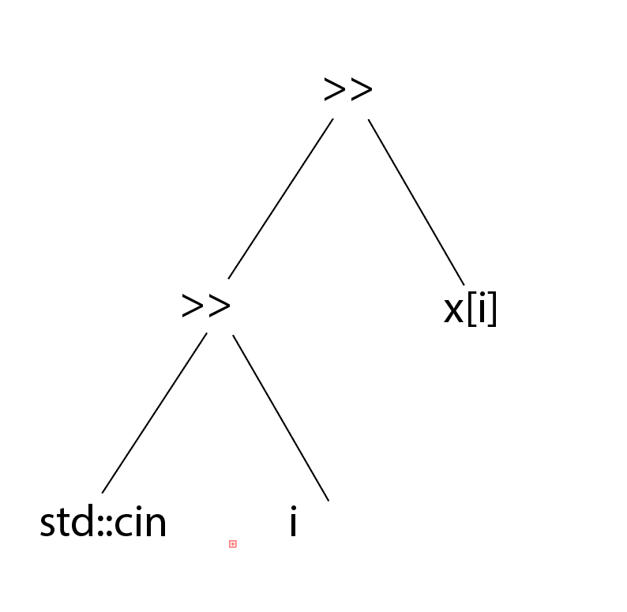

Но стандарт говорит, что порядок не определен до C++17. У меня в Visual Studio 2022 стандарт C++14 в настройках проекта.

Разберем по порядку:

Первый случай: g++ 14.2.0
1. Сначала вычисляется `std::cin >> i`
2. Ввод $1$ (i = 1)
3. Вычисляется `x[i]` -> `x[1]`
4. Ввод $5$ -> `x[1]` = 5
5. Вывод `x[1]` (5)

Второй случай:  Visual Studio 2022 (C++14)
1. Сначала вычисляется `x[i]` (i = 0) -> `x[0]` даёт 0
2. Вычисляется `std::cin >> i`
3. Ввод $1$ (i = 1)
4. Ввод $5$ -> `x[0]` = 5
5. Вывод `x[1]` (0)

## Дополнительные задания

### Задание 1 **(2)**

*Найдите и объясните примеры "коварных" ошибок программистов на С++, связанных с вычислением выражений. 
Каждый пример оценивается в два балла. Примеры из лекции или из заданий не засчитываются.*

### Задание 2 **(10)**
*Язык С++ позволяет записывать достаточно странные конструкции.
Следующая программа обладает неопределенным поведением. После компиляции с использованием 
Gnu C++ (g++) эта программа выводит числа 4 и 11. Рассмотрите ассемблерный код и объясните,
каким образом был получен ответ 11.*
```
int x, y;
y = (x=1) + (x=2) + (x=3) + (x=4);
std::cout << x << " " << y;
```

### Задание 3 **(10)**
*Прочитайте в стандарте языка С++ правила вычисления результата для тернарного оператора* **?:**. *Напишите примеры для каждого пункта правил.*
